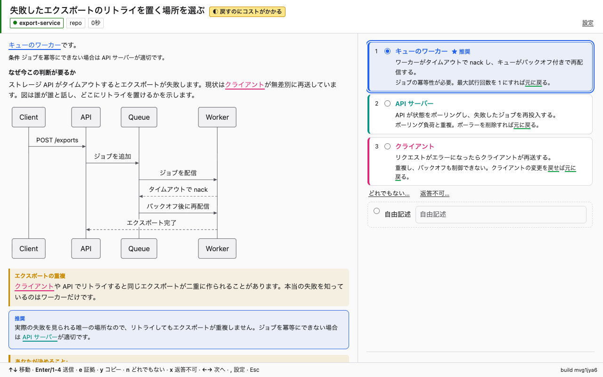
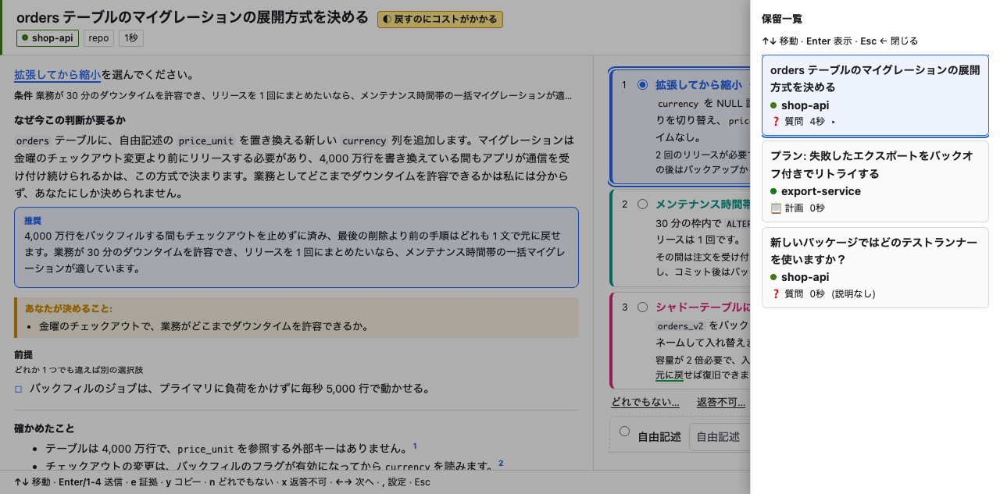
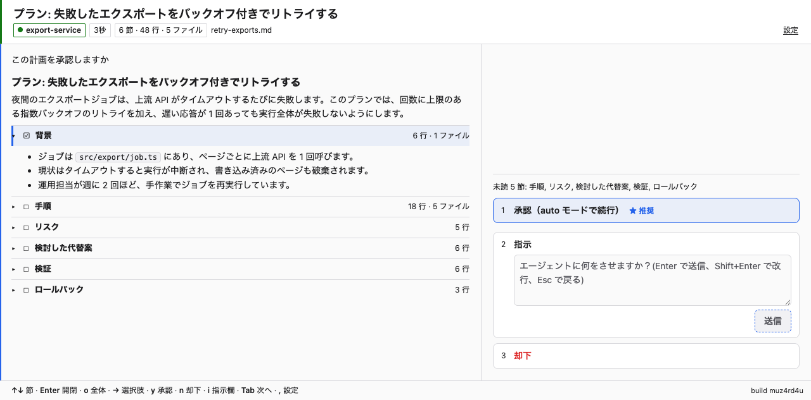
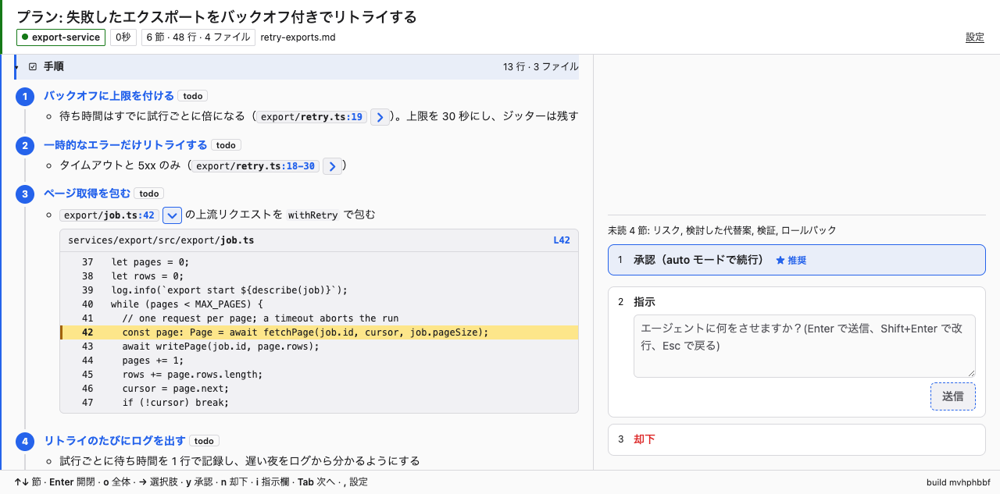
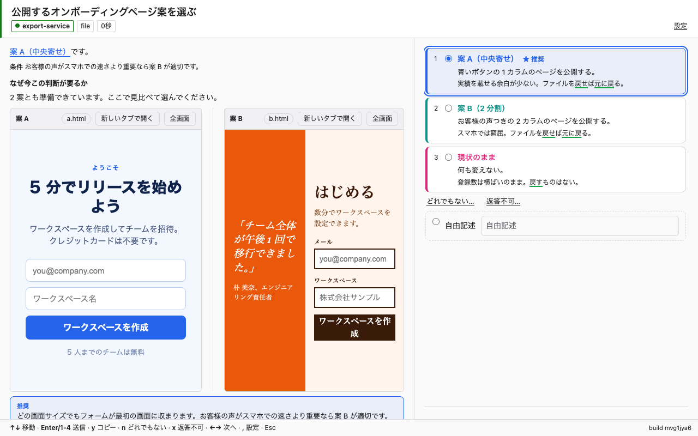
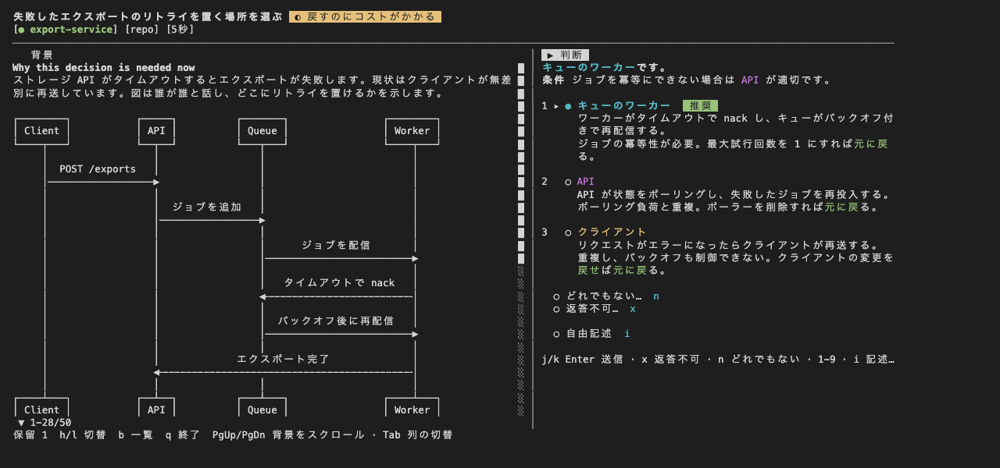

<p align="center"></p>


<h1 align="center">ukagai</h1>

<p align="center"><b>A decision inbox for Claude Code and Codex.</b><br>Agents ask. Humans decide.</p>

[English](README.md) | 日本語

ukagai は、Claude Code と Codex CLI の複数セッションが待っている質問とプラン承認を、1 つの受信箱（localhost の GUI、またはターミナル UI）に集めます。どの判断にも、エージェント自身が書いた説明が付きます。なぜ聞くのか、推奨、選択肢、図、diff です。

エージェントを並行して何本も動かす開発者向けです。止まっているセッションを探してターミナルを巡回し、スクロールして経緯を思い出す代わりに、1 か所で、選択肢のすぐ隣にある文脈を見て答えられます。

## どんな画面か



*1 つの判断。エージェントは、失敗したエクスポートのリトライをどこに置くかを聞いています。左は、なぜ聞くのか・シーケンス図・推奨。右は選択肢で、どれも元に戻す方法つきです。*



*待っているものを、セッションもプロジェクトも横断して 1 つの一覧に（`b`）。*

## クイックスタート

**必要なもの**: Node.js 22 以上、macOS または Linux（Windows は非対応）、Claude Code 2.1.304 以上と Codex CLI のどちらか（または両方）。動作確認は Claude Code 2.1.304、Codex CLI 0.159.3 で行っています。

> [!IMPORTANT]
> ukagai でプランを承認する前にお読みください。
>
> - **Claude Code: 「承認」は「auto モードで続行」です。** 「計画を確認した」だけでは済みません。GUI や TUI で承認すると、そのセッションが Claude Code の auto モードに切り替わります。承認だけのボタンはないので、保留したいときは **指示** か **却下** を使ってください。承認が効くのは、そのプラン 1 件を同じセッションで 1 回だけです。セッションの終了、新しいプランの提出、プランモードからの離脱で失効します。ukagai がモードを切り替えられなかったとき（たとえばプランが別の経路で通ったとき）は、通知で知らせます。Shift+Tab で自分で切り替えてください。
> - **Codex CLI: 端末側でも操作が要ります。** ukagai で承認すると Codex で実装が始まりますが、Codex 自身の「Implement this plan?」ポップアップは端末に残ります。そちらでは **No, stay in Plan mode** を選んでください。もう一度「Yes」を選ぶと、プランが 2 回実行されます。

1. **インストールします。**

   ```sh
   curl -fsSL https://raw.githubusercontent.com/Asugawara/ukagai/main/install.sh | sh
   ```

   ukagai を `~/.local/share/ukagai` に置き（`~/.local/bin/ukagai` にリンク）、見つかったエージェントすべてに登録します。

   - Claude Code: hooks を `~/.claude/settings.json` に、`ukagai-explain` スキルを `~/.claude/skills/ukagai-explain/` に、小さな mod を `~/.claude/skills/ukagai-mod/` に置きます。
   - Codex CLI: hooks を `$CODEX_HOME/hooks.json`（既定は `~/.codex`）に、その信頼エントリを `config.toml` に書きます。
   - 変更するファイルは、先にバックアップを取ります（`.bak-*`）。ukagai の設定・履歴・ログは `~/.ukagai` に置かれます。登録は `ukagai uninstall` で外せます。

2. **エージェントを起動します。** `claude`（または `codex`）を起動してください。すでに開いているセッションは開き直します。サーバーは自動で起動し、その日の最初のセッションで GUI（`http://127.0.0.1:4818`）が開きます。手動で起動するなら `ukagai serve` です。

3. **最初の質問に答えます。** エージェントに選択を求めてみてください。たとえば `AskUserQuestion で、新しいヘルパーの名前を A と B のどちらにするか聞いてください。` です（Codex ではプランモード `/plan` で）。質問が説明つきで GUI に届くので、選択肢を選んで `Enter` を押します（数字キーでも選べます）。
   - 最初のうちは、エージェントが説明を書き終えるまで ukagai が質問を保留します。赤い `[ukagai, not a failure]` の行が出て少し待つのは正常です。
   - 対話の Claude Code ターミナルでは、そのあとエージェントがターンを終え、回答は `[ukagai]` で始まるメッセージとして届きます。

4. **セットアップを確認します。** `ukagai doctor` は、最初のセッションまでは server と token を "not started yet" と表示し、そのあとは `no problems` と表示します。

GUI の言語は最初はロケールで決まり（`LC_ALL`、`LC_MESSAGES`、`LANG` のうち最初の空でない値が `ja` で始まれば `ja`、それ以外は `en`）、設定ページ（GUI で `,` キー）で変えられます。

## こんなときに

**複数セッションの判断を 1 か所に。** すべてのセッション、両方のエージェントの質問とプランが、1 つの保留一覧（`b`）に届きます。タブのアイコンとタイトルに件数が出て、設定でビープ音やブラウザ通知も足せます。どのカードにもプロジェクト名が付くので、どこが聞いているか分かります。[ガイド](docs/guide.md#the-decision-screen)

**スクロールで探さず、文脈を見て決める。** 説明はエージェント自身が書きます。なぜ今なのか、推奨、選択肢ごとに元に戻す方法を書いた表、Mermaid 図、関連する diff、確認した根拠です。[ガイド](docs/guide.md#rich-markdown)

**実行前にプランを確認する。** プランは、読んだ印のついた折りたたみのセクションで開きます。長い `path:line` の参照は短いチップになり、`▸` で行番号付きの前後のコードを開けます（クリックしたときにプロジェクトから読みます）。直したいときは指示（「先にこれをして」）を書きます。エージェントがプランを直して再提出し、新しい版には変更点の要約が付きます。Claude Code で承認すると auto モードになります（上記参照）。[ガイド](docs/guide.md#plan-approval)





*プランの長い `path:line` 参照は短いチップになり、`▸` でその行の前後のコードを開けます。*

**UI 案を並べて比べる。** エージェントは、UI やランディングページの案のような HTML ページ丸ごとを提案できます。ukagai は、ページ自身のスクリプトを実行しないサンドボックス化されたフレームで、選択肢のすぐ隣に表示します（全画面でのズーム表示、新しいタブでの表示にも対応）。[ガイド](docs/guide.md#rich-markdown)



*エージェントが提案した 2 つのランディングページ案を GUI で比べ、そのまま答えます。*

**止まっているエージェントの様子を見る。** Claude Code がセッション要約を書いたとき（Codex は 3 分間ターンがないとき）、それが進捗チェックになり、指示または停止で返答できます。[ガイド](docs/guide.md#progress-checkpoints)

**ターミナルで済ませたいとき。** `ukagai tui` は、同じ判断画面を vim 風のキーで出します。[ガイド](docs/guide.md#the-tui)



## 対応状況と制約

| | Claude Code | Codex CLI |
|---|---|---|
| 質問 | `AskUserQuestion` | プランモードの `request_user_input`、ターン終了時に文章で書かれた質問 |
| プラン承認 | `ExitPlanMode`（hook 経由） | プランモードで完成したプラン（Codex のローカル app-server 経由） |
| 承認したあと | セッションが auto モードに切り替わる | ukagai が Default モードで実装のターンを始める。端末の Codex のポップアップは「No, stay in Plan mode」で閉じる |
| コマンドの承認 | 端末に残る | Allow / Deny のカード |
| 進捗チェック | セッション要約から | 新しいターンが 3 分間ないとき（既定） |
| 動作確認したバージョン | 2.1.304 | 0.159.3 |

- **エージェントが先に説明を書きます。** 質問やプランの最初の呼び出しは、エージェントが説明を書き終えるまで保留されます。そのぶんエージェントの時間とトークンがかかります。書き方はスキルと短い文脈の一文で教えます。
- **回答をメッセージで届ける（Claude Code）。** 対話のターミナルでは、エージェントは待たずにターンを終え、手が空いたところで回答がメッセージとして届きます。`claude -p`、Agent SDK、Desktop、VS Code のチャット、サブエージェント、Codex では、hook が回答を待ちます。既定でオンで、オフにする方法は 3 つあります。[ガイド](docs/guide.md#answers-as-messages-the-ukagai-mod)
- **サーバーに届かないとき**は、hook は何も出力せず、エージェントは通常の端末のプロンプトに戻ります。
- **Codex のプラン承認**には、サーバーが Codex のローカル app-server につながっている必要があります。Codex の起動後、つながるまでに最大 30 秒ほどかかります。Codex の Default モードで質問を受けるには、Codex の `config.toml` に `features.default_mode_request_user_input = true` が必要です（ukagai は書き込みません）。[ガイド](docs/guide.md#codex-cli)
- **ローカルのみ。** サーバーは `127.0.0.1:4818` で待ち受けます。ユーザーガイドは英語です。

## 詳細

### 仕組み

エージェントが `AskUserQuestion` や `ExitPlanMode` を呼ぶと、`PreToolUse` hook がまず 1 回その呼び出しを拒否し、説明ファイルを書くようエージェントに求めます（書式は `ukagai-explain` スキルが教えます）。再試行では、hook が判断をローカルのサーバーに登録し、GUI または TUI での回答を待ち、ツールの結果としてエージェントに返します。MCP は使いません。hooks、スキル、GUI で動きます。

GUI はビルド不要の静的な HTML と JS です。Mermaid の図は mermaid.js（5.5 MB）ではなく [pele](https://github.com/obsidianmd/pele)（682 KB）で描きます。

### ガイドの項目

- [判断画面](docs/guide.md#the-decision-screen): エージェントの推奨付きの選択肢、すべてキーで操作可能、保留一覧。
- [プラン承認](docs/guide.md#plan-approval): 承認、指示、却下。コード参照。
- [進捗チェックポイント](docs/guide.md#progress-checkpoints)
- [TUI](docs/guide.md#the-tui)
- [回答をメッセージで届ける](docs/guide.md#answers-as-messages-the-ukagai-mod)
- [Codex CLI](docs/guide.md#codex-cli): hooks とプラン承認用のブリッジ。
- [設定](docs/guide.md#settings): 言語、テーマ、通知、プランファイルの自動表示（既定はオフ）、エージェントが従うスキルの本文。
- [Rich Markdown](docs/guide.md#rich-markdown): 説明やプランで使えるコールアウト、Mermaid、diff、タスクリストなど。

### インストールのオプション

`install.sh` はバイナリを入れたあと `ukagai install` を実行し、見つかったエージェントすべてに hooks とスキルを登録します（先に設定のバックアップを取ります）。Claude Code には、ukagai mod も専用の小さなプラグインとして `~/.claude/skills/ukagai-mod/` に置きます（ukagai プラグインが有効なときは、プラグインが mod を持ってくるので置きません）。`wget` でも実行できます。

次の条件で、そのエージェントが見つかったとみなします。

- Claude Code: 実行可能な `claude` が `PATH` にある、または `~/.claude.json` か `~/.claude/projects/` がある（`~/.claude` があるだけでは数えません）。
- Codex CLI: 実行可能な `codex` が `PATH` にある、または `<Codex home>/sessions/` がある（Codex home は `$CODEX_HOME`、既定は `~/.codex`）。

どちらも見つからなければ、`ukagai install` はそう表示して終了コード 0 で終わります。エージェントを入れてから、もう一度 `ukagai install` を実行してください。

| フラグ | 意味 |
|---|---|
| `--version vX.Y.Z` | このバージョンを入れる（既定は最新リリース） |
| `--force` | bin パスにある ukagai 以外のファイルを置き換える |

古い `--lang`、`--codex`、`--claude` は警告を出して無視されます。`ukagai install`、`uninstall`、`doctor` も `--lang` を同じように無視します。言語は設定ページで変えます。片方のエージェントだけに登録するなら、自分で `ukagai install --claude` または `ukagai install --codex` を実行してください。

| 環境変数 | 意味 |
|---|---|
| `UKAGAI_HOME`, `UKAGAI_BIN_DIR` | バージョンの置き場所（`~/.local/share/ukagai`）と `ukagai` のリンク先（`~/.local/bin`） |
| `UKAGAI_DATA_DIR` | `ukagai install` に `--data-dir` として渡されます（既定は `~/.ukagai`） |
| `UKAGAI_PORT` | 古いバージョンを削除する前に確認する、起動中サーバーのポート（既定は 4818） |
| `UKAGAI_NODE`, `UKAGAI_DOWNLOADER`, `UKAGAI_VERSION` | Node.js のパス、`curl` か `wget`、バージョン |

**プラグインマーケットプレイス**（`install.sh` の代わり。データは `~/.ukagai` に残ります）:

- Claude Code: `/plugin marketplace add Asugawara/ukagai`、続けて `/plugin install ukagai@ukagai`。
- Codex CLI: `codex plugin marketplace add Asugawara/ukagai`、続けて `codex plugin add ukagai@ukagai`。そのあと Codex の TUI で `/hooks` を実行し、hooks を信頼してください。

プラグインだけを使っている場合、シェルで `ukagai` は打てません。Claude Code ではエージェントの Bash ツール経由で `"${CLAUDE_PLUGIN_ROOT}/bin/ukagai" doctor` を実行してください。`install.sh` も実行済みの場合は、`ukagai install` が自身の登録を外し、hooks が二重に動かないようにします。

### 更新

インストールのコマンドをもう一度実行します。登録済みのエージェントだけを登録し直し、オプション（`--timeout`、`--observe`、`--no-autostart`、`--server`、`--data-dir`）はそのまま引き継がれます。オプションを既定に戻すには、`ukagai uninstall` のあとに `ukagai install` を実行してください。起動中のサーバーは次のセッション開始時に置き換わります（そのサーバーが保持していた判断はターミナルに戻ります）。

### doctor

うまく動かないときは `ukagai doctor` を実行してください（[トラブルシューティング](docs/guide.md#troubleshooting)）。

### アンインストール

`ukagai uninstall`（先に `--dry-run`）で Claude Code と Codex CLI の両方から hooks、スキル、ukagai mod を外します（片方だけなら `--claude` または `--codex`）。hooks が残らなくなればサーバーも止まります（片方が失敗しても、もう片方は外れます。終了コードは 1 で、サーバーは止まらずに残ります）。そのあと `rm -rf ~/.local/share/ukagai ~/.local/bin/ukagai` を実行してください。`~/.ukagai`（設定・履歴・ログ）は残るので、消すなら `rm -rf ~/.ukagai` です。プラグインは `/plugin uninstall ukagai@ukagai` または `codex plugin remove ukagai` です。

### ドキュメント

| パス | 内容 |
|---|---|
| `docs/guide.md` | ユーザーガイド（英語）: 画面、キー、チェックポイント、TUI、設定、Codex、トラブルシューティング |
| `docs/strategy/` | 実装計画（`03-*` MVP、`04-*` 配布） |
| `docs/spec/api.md` | サーバー API、状態遷移、認可 |
| `docs/spec/explain.md` | エージェントが書く説明ファイルと、hook の検証ルール |
| `docs/spec/markdown.md` | 説明とプランを書くための Markdown 方言 |
| `docs/spec/codex-bridge.md` | Codex ブリッジ: Codex app-server 経由のプラン承認と進捗チェックポイント |
| `docs/verification/` | 実環境での検証記録（01 質問の注入、02 Codex の hooks と hook の限界、03 E2E、04 プラン作成時の文脈、05 プランの指示と approve-and-auto、06 プラン承認後のモード、起こされたターンと進捗チェック、07 すべての配布経路でのリリースからのインストール、08 編集したスキルが権限プロンプトなしで読まれること） |
| `skills/ukagai-explain/` | Claude に説明の書き方を教えるスキル（`SKILL.md`）と、必要なときに読む `reference/` のファイル |

## 開発

```sh
git clone https://github.com/Asugawara/ukagai.git && cd ukagai
npm ci
npm run build
npm run vendor                              # marked / pele を public/vendor/ にバンドル
node dist/cli.js install --dry-run          # 見つかったエージェントへの変更をプレビュー
node dist/cli.js install                    # hooks + スキルを登録
npm run typecheck
npm test              # GUI テスト（test/gui/）は agent-browser があるときだけ実行
npm run dev:serve
```

実際の設定に触れずに試すには、別ファイルに書き込み、それを使ってテストセッションを起動します（スキルには触れません。スキルも置くなら `--skill` を追加）。

```sh
node dist/cli.js install --settings /tmp/ukagai-settings.json --data-dir /tmp/ukagai-data
claude --settings /tmp/ukagai-settings.json
```

`claude --settings <file>` はグローバル設定と併用されるため、グローバルに入れた hook もテストセッションで動き、実際のキューに書き込みます。`UKAGAI_DISABLE=1 claude …` で起動するとグローバルの hook を無効にできます（`hook` サブコマンドは何も出力せず、どのイベントでも exit 0 で終わります）。または、テスト用の設定ファイルにだけ hook を入れてください。

リリース: `npm run release:stage`（`sh scripts/build-release.sh <version> out`）がリリースツリーを作り、`out/` に `ukagai-<version>.tar.gz` と `SHA256SUMS` を書き出します。残りは CI が行います。

- `main` への Conventional Commits を受けて、release-please がリリース PR を開きます。
- その PR をマージすると、タグとドラフトのリリースが作られます。
- package ジョブが tarball と `SHA256SUMS` をビルドします。
- publish ジョブがそれらをアップロードし、リリースを公開します。
- plugin ジョブがステージしたツリーを `plugin` ブランチに push します。両方のマーケットプレイスがこのブランチを読みます。

冒頭のデモは `npm run demo` で実際の GUI から描画し（Chrome、img2webp、ffmpeg が必要）、`npm run demo:publish` で PR に添付したものです。`demo/README.md` を参照。

## ライセンス

MIT。[LICENSE](LICENSE) を参照してください。サードパーティのライセンスは `public/vendor/LICENSES.md` にあります。
