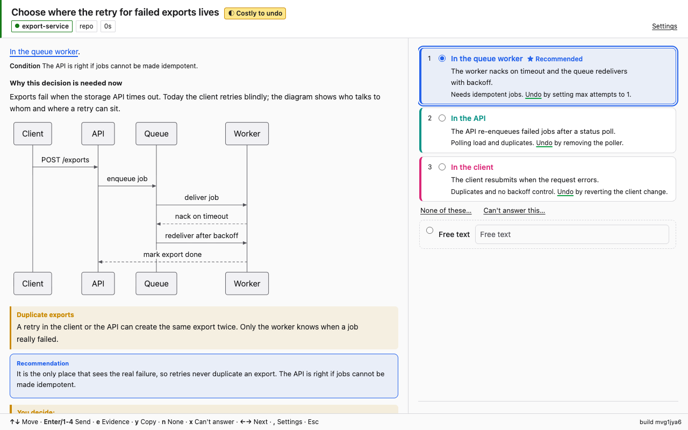
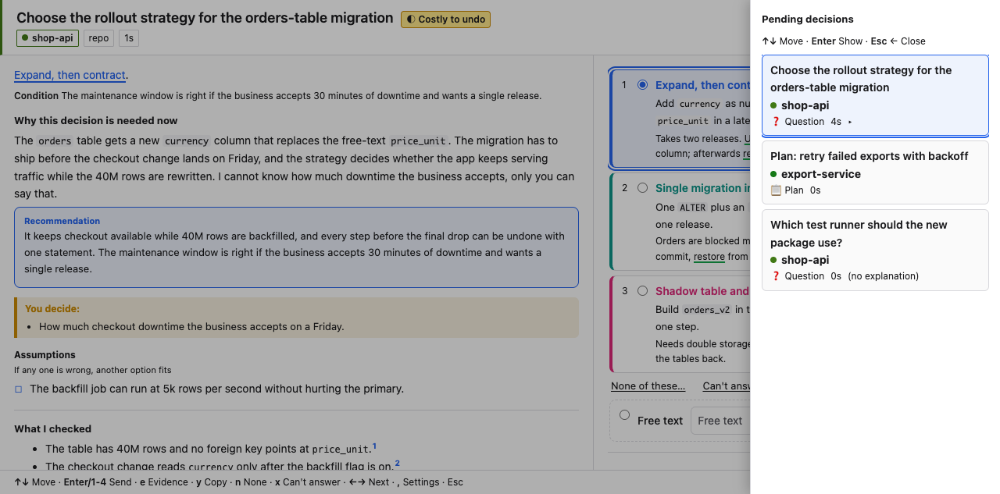
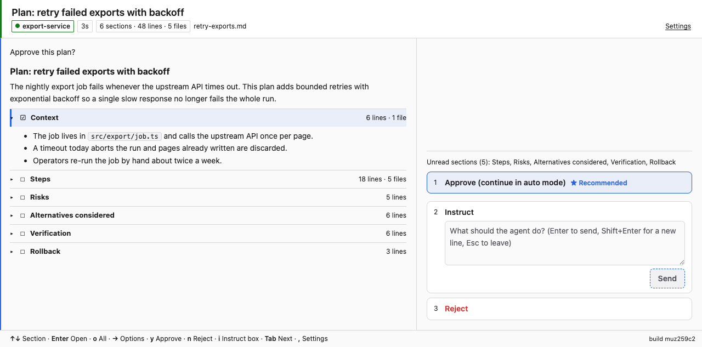
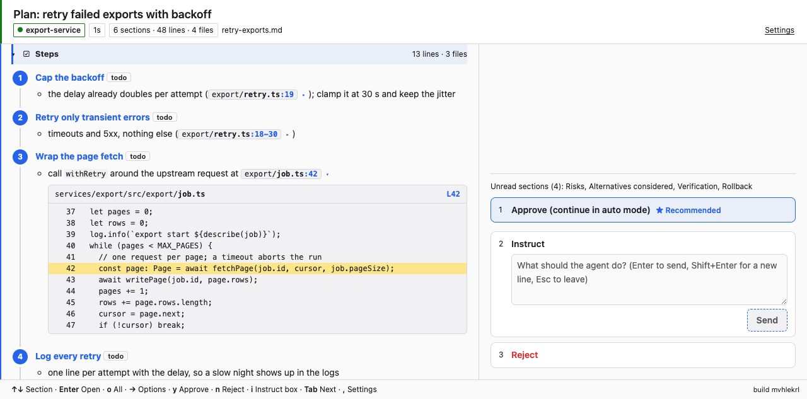
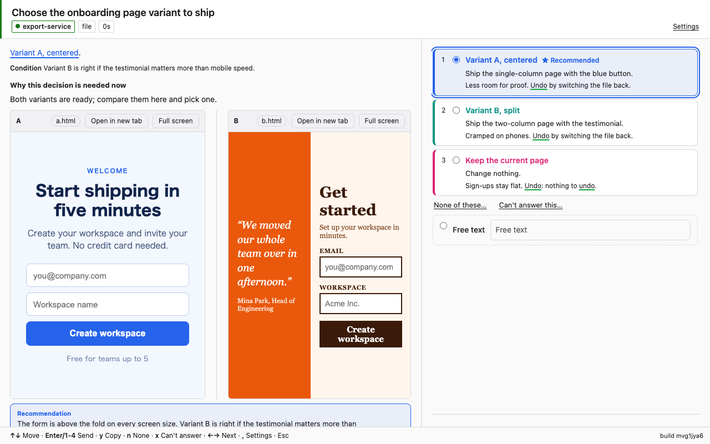
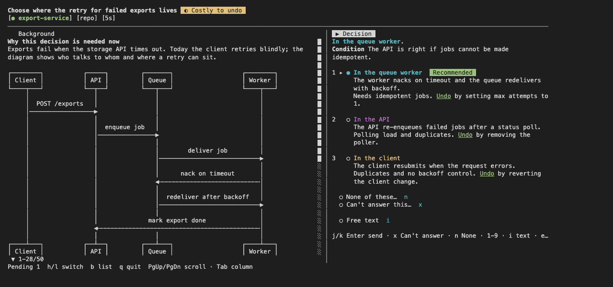

<p align="center"></p>

<h1 align="center">ukagai</h1>

<p align="center"><b>A decision inbox for Claude Code and Codex.</b><br>Agents ask. Humans decide.</p>

English | [日本語](README.ja.md)

ukagai gathers the questions and plan approvals your Claude Code and Codex CLI sessions are waiting on into one inbox (a localhost GUI, or a terminal UI). Each one comes with the agent's own explanation: why it is asking, a recommendation, the options, a diagram and a diff.

It is for developers who run several agent sessions at once. Instead of walking through terminals to find the session that stopped, then scrolling back to remember what it was doing, you answer from one place with the context next to the options.

## What you see



*One decision. The agent asks where the retry for failed exports should live. Left: why it is asking, a sequence diagram and its recommendation. Right: the options, each with how to undo it.*



*Everything that is waiting, across sessions and projects, in one list (`b`).*

## Quick start

**Requirements**: Node.js 22 or later, macOS or Linux (Windows is not supported), and Claude Code 2.1.304 or later and / or Codex CLI. Verified on Claude Code 2.1.304 and Codex CLI 0.159.3.

> [!IMPORTANT]
> Read this before you approve a plan in ukagai.
>
> - **Claude Code: Approve means "continue in auto mode".** It is not just "I read the plan". Approving in the GUI or TUI switches that session to Claude Code's auto mode, and there is no plain-approve button; to hold a plan back, use **Instruct** or **Reject**. The approval covers that one plan, once, in the same session, and lapses when the session ends, a new plan arrives or the session leaves plan mode. If ukagai could not switch the mode (for example the plan went through some other way), a notice says so; switch it yourself with Shift+Tab.
> - **Codex CLI: finish in the terminal too.** After you approve in ukagai, it starts the implementation in Codex, but Codex's own "Implement this plan?" popup stays open in the terminal. Choose **No, stay in Plan mode** there; a second "Yes" runs the plan twice.

1. **Install.**

   ```sh
   curl -fsSL https://raw.githubusercontent.com/Asugawara/ukagai/main/install.sh | sh
   ```

   This puts ukagai in `~/.local/share/ukagai` (linked as `~/.local/bin/ukagai`) and registers it with every agent it finds:

   - Claude Code: hooks in `~/.claude/settings.json`, the `ukagai-explain` skill in `~/.claude/skills/ukagai-explain/` and a small mod in `~/.claude/skills/ukagai-mod/`.
   - Codex CLI: hooks in `$CODEX_HOME/hooks.json` (default `~/.codex`) and their trust entries in `config.toml`.
   - Each file it changes is backed up first (`.bak-*`). Your ukagai settings, history and logs live in `~/.ukagai`. `ukagai uninstall` takes the registration out again.

2. **Start an agent.** Run `claude` (or `codex`); restart a session that was already open. The server starts by itself and the GUI (`http://127.0.0.1:4818`) opens in your first session of the day. `ukagai serve` starts it by hand.

3. **Answer your first question.** Ask the agent for a choice, for example `Ask me with AskUserQuestion whether to call a new helper A or B.` (in Codex, use Plan mode: `/plan`). The question appears in the GUI with its explanation; pick an option and press `Enter` (number keys work too).
   - The first time, ukagai holds the question until the agent has written its explanation, so a red `[ukagai, not a failure]` line and a short wait are normal.
   - In an interactive Claude Code terminal, the agent then ends its turn and your answer arrives as a message that starts with `[ukagai]`.

4. **Check the setup.** `ukagai doctor` reports the server and the token as "not started yet" until your first session, and `no problems` after it.

The GUI language starts from your locale (`ja` if `LC_ALL`, `LC_MESSAGES` or `LANG` starts with `ja`, otherwise `en`); change it on the Settings page (`,` key in the GUI).

## What it is good for

**Several sessions, one list.** Questions and plans from every session and both agents land in one pending list (`b`). The tab icon and title show the count, and Settings can add a beep or a browser notification. Each card is labelled with its project, so you know who is asking. [Guide](docs/guide.md#the-decision-screen)

**Decide with context, not scroll-back.** The agent writes the explanation itself: why it is asking now, a recommendation, an options table that says how to undo each choice, a Mermaid diagram, related diffs and what it checked. [Guide](docs/guide.md#rich-markdown)

**Review a plan before it runs.** A plan opens as folded sections with read marks. A long `path:line` reference becomes a short chip, and `▸` opens the numbered code around the line, read from your project when you click. To change a plan, type an instruction ("do this first"): the agent revises it and asks again, and the new version comes with a summary of what changed. Approve means auto mode in Claude Code (see above). [Guide](docs/guide.md#plan-approval)





*Long `path:line` references in a plan become short chips; `▸` opens the code around the line.*

**Compare UI options side by side.** An agent can propose whole HTML pages, such as UI or landing-page variants. ukagai shows them next to the options in a sandboxed frame that runs none of the page's own scripts (full screen with zoom, or in a new tab). [Guide](docs/guide.md#rich-markdown)



*Two landing-page variants proposed by the agent, compared in the GUI and answered there.*

**Check in on idle agents.** When Claude Code writes a session recap (or a Codex session has been quiet for 3 minutes), it becomes a progress check you can answer with an instruction or a stop. [Guide](docs/guide.md#progress-checkpoints)

**Stay in the terminal if you like.** `ukagai tui` shows the same decision screen with vim-style keys. [Guide](docs/guide.md#the-tui)



## Support and limits

| | Claude Code | Codex CLI |
|---|---|---|
| Questions | `AskUserQuestion` | `request_user_input` in Plan mode; a question written as prose when the turn stops |
| Plan approval | `ExitPlanMode`, through the hook | A finished Plan-mode plan, through Codex's local app-server |
| After you approve | The session switches to auto mode | ukagai starts the implementation turn in Default mode. In the terminal, answer Codex's popup with "No, stay in Plan mode" |
| Command approvals | Stay in the terminal | An Allow / Deny card |
| Progress check | From the session recap | After 3 minutes without a new turn (default) |
| Verified on | 2.1.304 | 0.159.3 |

- **The agent writes an explanation first.** The first call to a question or a plan is held until the agent has written it, which costs the agent a little time and tokens. The skill and a short context sentence teach it how.
- **Answers as messages (Claude Code).** In an interactive terminal the agent ends its turn instead of waiting, and your answer arrives as a message once it is idle. In `claude -p`, the Agent SDK, Desktop, the VS Code chat, subagents and Codex, the hook waits for your answer instead. It is on by default and has three ways to turn it off. [Guide](docs/guide.md#answers-as-messages-the-ukagai-mod)
- **If the server cannot be reached**, the hook prints nothing and the agent falls back to its normal terminal prompt.
- **Codex plan approval** needs the server to attach to Codex's local app-server, which can take up to about 30 seconds after Codex starts. Questions in Codex's Default mode need `features.default_mode_request_user_input = true` in its `config.toml` (ukagai does not write it). [Guide](docs/guide.md#codex-cli)
- **Local only.** The server listens on `127.0.0.1:4818`. The user guide is in English.

## Details

### How it works

When the agent calls `AskUserQuestion` or `ExitPlanMode`, a `PreToolUse` hook first denies the call once and asks the agent to write an explanation file (the `ukagai-explain` skill teaches the format). On the retry, the hook registers the decision with the local server, waits for your answer in the GUI or TUI, and hands it back to the agent as the tool's result. No MCP is involved: it is hooks, a skill and a GUI.

The GUI is static HTML and JS with no build step. Mermaid diagrams are drawn by [pele](https://github.com/obsidianmd/pele) (682 KB) instead of mermaid.js (5.5 MB).

### Guide topics

- [Decision screen](docs/guide.md#the-decision-screen): options with the agent's recommendation, keys for everything, the pending list.
- [Plan approval](docs/guide.md#plan-approval): approve, instruct or reject; code references.
- [Progress checkpoints](docs/guide.md#progress-checkpoints)
- [TUI](docs/guide.md#the-tui)
- [Answers as messages](docs/guide.md#answers-as-messages-the-ukagai-mod)
- [Codex CLI](docs/guide.md#codex-cli): hooks plus a bridge for plan approval.
- [Settings](docs/guide.md#settings): language, theme, notifications, plan-file pop-up (off by default) and the skill text the agent follows.
- [Rich Markdown](docs/guide.md#rich-markdown): callouts, Mermaid, diffs, task lists and more in explanations and plans.

### Install options

`install.sh` installs the binary and then runs `ukagai install`, which registers the hooks and the skill for every agent it finds (and backs up your settings first). For Claude Code it also places the ukagai mod as a small plugin of its own at `~/.claude/skills/ukagai-mod/` (skipped when the ukagai plugin is enabled, which brings the mod itself). `wget` works too.

An agent counts as found when:

- Claude Code: an executable `claude` is on `PATH`, or `~/.claude.json` or `~/.claude/projects/` exists (a bare `~/.claude` does not count).
- Codex CLI: an executable `codex` is on `PATH`, or `<Codex home>/sessions/` exists (Codex home is `$CODEX_HOME`, default `~/.codex`).

If neither is found, `ukagai install` says so and exits 0; install an agent and run `ukagai install` again.

| Flag | Meaning |
|---|---|
| `--version vX.Y.Z` | Install this version (default: latest release) |
| `--force` | Replace a non-ukagai file at the bin path |

The old `--lang`, `--codex` and `--claude` are ignored with a warning, and `ukagai install`, `uninstall` and `doctor` ignore `--lang` the same way. The language is set on the Settings page. To register one agent only, run `ukagai install --claude` or `ukagai install --codex` yourself.

| Environment | Meaning |
|---|---|
| `UKAGAI_HOME`, `UKAGAI_BIN_DIR` | Where versions are installed (`~/.local/share/ukagai`) and where `ukagai` is linked (`~/.local/bin`) |
| `UKAGAI_DATA_DIR` | Forwarded to `ukagai install` as `--data-dir` (default `~/.ukagai`) |
| `UKAGAI_PORT` | Port of the running server checked before old versions are pruned (default 4818) |
| `UKAGAI_NODE`, `UKAGAI_DOWNLOADER`, `UKAGAI_VERSION` | Node.js path, `curl` or `wget`, version |

**Plugin marketplaces** (instead of `install.sh`; the data stays in `~/.ukagai`):

- Claude Code: `/plugin marketplace add Asugawara/ukagai`, then `/plugin install ukagai@ukagai`.
- Codex CLI: `codex plugin marketplace add Asugawara/ukagai`, then `codex plugin add ukagai@ukagai`, then run `/hooks` in the Codex TUI and trust the hooks.

A plugin-only user cannot type `ukagai` in the shell: run `"${CLAUDE_PLUGIN_ROOT}/bin/ukagai" doctor` through the agent's Bash tool in Claude Code. If you also ran `install.sh`, `ukagai install` removes its own registration so the hooks run once.

### Update

Run the install command again. It re-registers only the agents that are already registered, and keeps their options (`--timeout`, `--observe`, `--no-autostart`, `--server`, `--data-dir`); to put the options back to the defaults, run `ukagai uninstall` and then `ukagai install`. A running server is replaced at the next session start (decisions it still held fall back to the terminal).

### Doctor

Something wrong? Run `ukagai doctor` ([troubleshooting](docs/guide.md#troubleshooting)).

### Uninstall

`ukagai uninstall` (`--dry-run` first) removes the hooks, the skill and the ukagai mod from both Claude Code and Codex CLI (`--claude` or `--codex` picks one) and stops the server once no hooks remain (if one agent fails, the other is still removed, the command exits 1 and the server is left running). Then run `rm -rf ~/.local/share/ukagai ~/.local/bin/ukagai`. `~/.ukagai` (settings, history, logs) is kept; `rm -rf ~/.ukagai` removes it too. For plugins: `/plugin uninstall ukagai@ukagai` or `codex plugin remove ukagai`.

### Documentation

| Path | Content |
|---|---|
| `docs/guide.md` | The user guide: screens, keys, checkpoints, TUI, Settings, Codex, troubleshooting |
| `docs/strategy/` | The implementation plans (`03-*` MVP, `04-*` distribution) |
| `docs/spec/api.md` | Server API, state transitions, authorization |
| `docs/spec/explain.md` | The explanation file the agent writes and the hook's validation rules |
| `docs/spec/markdown.md` | The Markdown dialect explanations and plans are written in |
| `docs/spec/codex-bridge.md` | The Codex bridge: plan approval and progress checkpoints through the Codex app-server |
| `docs/verification/` | Records of real-environment verification (01 question injection, 02 Codex hooks and hook limits, 03 E2E, 04 plan-writing context, 05 plan instruct and approve-and-auto, 06 the mode after plan approval, wake-up turns and the progress check, 07 install from the release on every distribution path, 08 the edited skill is read without a permission prompt) |
| `skills/ukagai-explain/` | The skill (`SKILL.md`) that teaches Claude how to write explanations, plus the `reference/` files it reads when needed |

## Development

```sh
git clone https://github.com/Asugawara/ukagai.git && cd ukagai
npm ci
npm run build
npm run vendor                              # bundle marked / pele into public/vendor/
node dist/cli.js install --dry-run          # preview the changes to the agents found
node dist/cli.js install                    # register hooks + skill
npm run typecheck
npm test              # GUI tests (test/gui/) run only when agent-browser is available
npm run dev:serve
```

To try it without touching your real settings, write to a separate file and start a test session with it (the skill is left alone; add `--skill` to place it too):

```sh
node dist/cli.js install --settings /tmp/ukagai-settings.json --data-dir /tmp/ukagai-data
claude --settings /tmp/ukagai-settings.json
```

`claude --settings <file>` is used together with the global settings, so a globally installed hook also fires in a test session and writes into your real queue. Run `UKAGAI_DISABLE=1 claude …` to silence the global hook (the `hook` subcommand then prints nothing and exits 0 for every event), or enable only the hook in the test settings file.

Releases: `npm run release:stage` (`sh scripts/build-release.sh <version> out`) stages the release tree and writes `ukagai-<version>.tar.gz` and `SHA256SUMS` into `out/`. CI does the rest:

- Conventional commits on `main` make release-please open a release PR.
- Merging that PR creates the tag and a draft release.
- The package job builds the tarball and `SHA256SUMS`.
- The publish job uploads them and publishes the release.
- The plugin job pushes the stage tree to the `plugin` branch, which both marketplaces read.

## License

MIT, see [LICENSE](LICENSE). Third-party licences: `public/vendor/LICENSES.md`.
