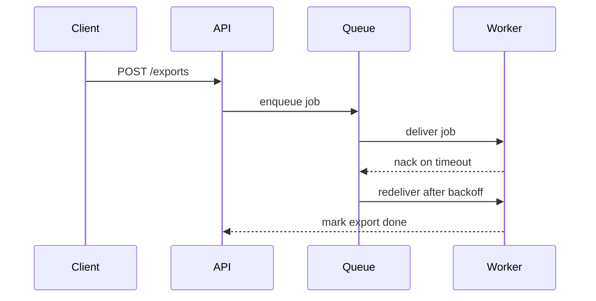

## Why this decision is needed now

Exports fail when the storage API times out. Today the client retries blindly; the diagram shows who talks to whom and where a retry can sit.

> [!WARNING] Duplicate exports
> A retry in the client or the API can create the same export twice. Only the worker knows when a job really failed.

## Options

| Option | What happens if chosen | Risks and how to undo |
|---|---|---|
| In the queue worker | The worker nacks on timeout and the queue redelivers with backoff. | Needs idempotent jobs. Undo by setting max attempts to 1. |
| In the API | The API re-enqueues failed jobs after a status poll. | Polling load and duplicates. Undo by removing the poller. |
| In the client | The client resubmits when the request errors. | Duplicates and no backoff control. Undo by reverting the client change. |

## Recommendation

In the queue worker. It is the only place that sees the real failure, so retries never duplicate an export. The API is right if jobs cannot be made idempotent.

## What only you know

- Whether the export jobs can be made idempotent.

## Assumptions

- The storage API timeouts are transient.

## What I checked

Export failures come from storage API timeouts.[^1]

[^1]: export-service/logs
