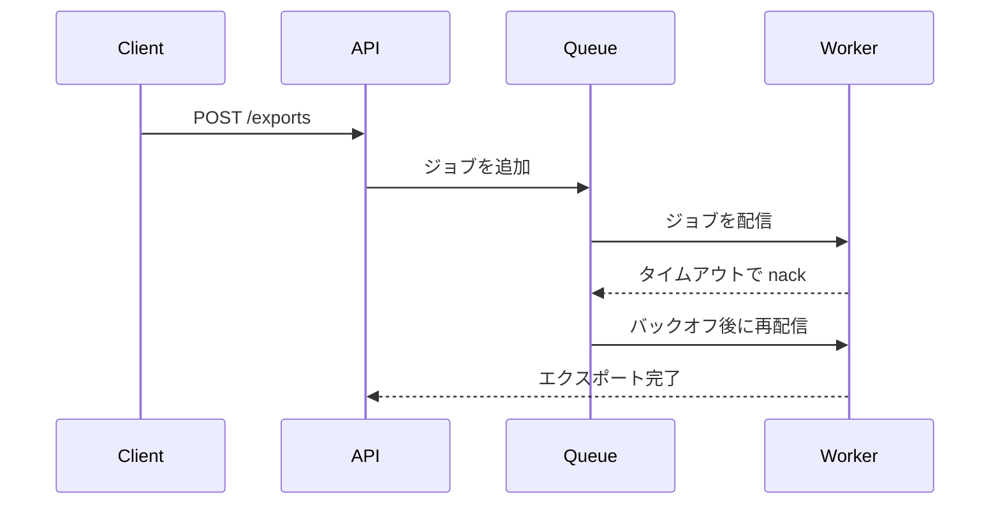

## なぜ今この判断が要るか

ストレージ API がタイムアウトするとエクスポートが失敗します。現状はクライアントが無差別に再送しています。図は誰が誰と話し、どこにリトライを置けるかを示します。

> [!WARNING] エクスポートの重複
> クライアントや API でリトライすると同じエクスポートが二重に作られることがあります。本当の失敗を知っているのはワーカーだけです。

## 選択肢

| 選択肢 | 選んだ場合 | リスクと元に戻す方法 |
|---|---|---|
| キューのワーカー | ワーカーがタイムアウトで nack し、キューがバックオフ付きで再配信する。 | ジョブの冪等性が必要。最大試行回数を 1 にすれば元に戻る。 |
| API サーバー | API が状態をポーリングし、失敗したジョブを再投入する。 | ポーリング負荷と重複。ポーラーを削除すれば元に戻る。 |
| クライアント | リクエストがエラーになったらクライアントが再送する。 | 重複し、バックオフも制御できない。クライアントの変更を戻せば元に戻る。 |

## 推奨

キューのワーカーです。実際の失敗を見られる唯一の場所なので、リトライしてもエクスポートが重複しません。ジョブを冪等にできない場合は API サーバーが適切です。

## あなたにしか分からないこと

- エクスポートのジョブを冪等にできるかどうか。

## 前提

- ストレージ API のタイムアウトは一時的なものです。

## 確かめたこと

エクスポートの失敗はストレージ API のタイムアウトで起きています[^1]。

[^1]: export-service/logs
