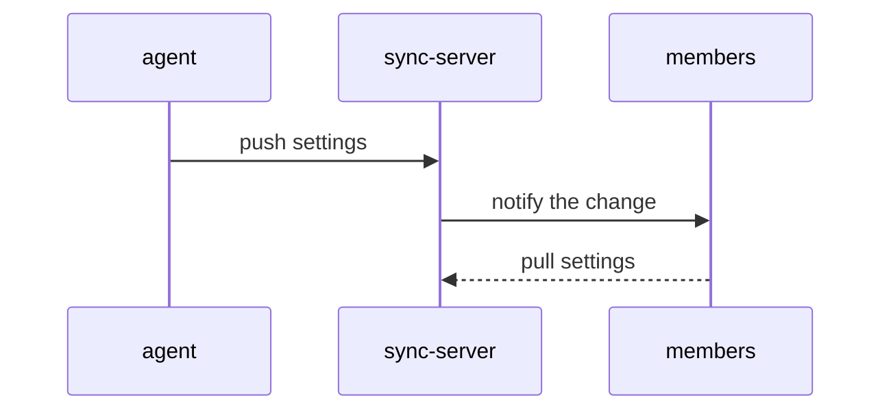

## Why this decision is needed now

共有サーバーは他のメンバーも読みます。同期すると他の人の環境に設定が届くため、先に人が決めます。

## Options

シーケンスは下の図のとおりです。

| Option | What happens if chosen | Risks and how to undo |
|---|---|---|
| 今すぐ同期する | 設定がサーバー経由で全員に届く。 | 間違えたらサーバーの履歴から前の版に戻せます。 |
| ローカルのままにする | 自分の環境だけで使う。 | 何も変わらない。いつでも同期できます。 |

## Recommendation

今すぐ同期するのが良いです。設定の履歴がサーバーに残り、戻せます。ローカルのままにする案が合うのは、設定がまだ試作の場合です。

## What only you know

- 他のメンバーが今その設定を使っているかどうか。

## Assumptions

- サーバーは履歴を 30 日間保持する。

## What I checked

- サーバーの履歴機能を設定ファイルで確認した[^1]。

[^1]: `sync.toml` の `history_days = 30`。
