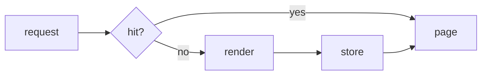

## Why this decision is needed now

KEEPWHY: the report page is slow on a cold start, and the choice decides which module owns the cache.


## What only you know

- Whether two processes will read the report page at once.

KEEPUNKNOWNS: this note sits next to the bullet and must stay on screen.

```text
KEEPCODEUNKNOWNS no process shares the cache today
```

## Terms

- **LRU** — Least Recently Used: the entry that was read longest ago is dropped first.

KEEPTERMS: a paragraph under Terms that is not a bullet.


## Options

KEEPOPTBEFORE: the measurements are in the screenshot and the sketch below.


```text
KEEPCODEOPTBEFORE request -> cache -> page
```

| Option | What happens if chosen | Risks and how to undo |
|---|---|---|
| Memory cache | Entries live in the process; a restart empties them. | Stale pages after a deploy. Undo: remove the cache module and redeploy. |
| Disk cache | Entries survive a restart; reads cost one file read. | Disk fills up over time. Undo: delete the cache directory. |

KEEPOPTAFTER: the table above is the whole comparison.




No diagram: the flow above only shows the cache lookup; the options differ in where entries are stored, which a diagram would not add.

## Recommendation

I recommend the memory cache. It needs no new files and a restart clears every stale entry. If two processes must share the cache, the disk cache is the right choice.

KEEPREC: a note inside the recommendation.


## Assumptions

- Only one process serves the report page.

KEEPASSUMPTIONS: a note that follows the assumptions list.

```text
KEEPCODEASSUMPTIONS one worker
```

## Counterargument

KEEPAGAINST: a disk cache is simple too, and it would also speed up the next start.


## Affected

- `src/report/cache.ts`

KEEPAFFECTED: a note that follows the list of affected files.

```text
KEEPCODEAFFECTED src/report/
```

## What I checked

- The report page renders in 2 s without a cache.[^1]

KEEPCHECKED: a note under the evidence list.


[^1]: KEEPFOOTNOTE: measured with `time curl localhost:3000/report`.
